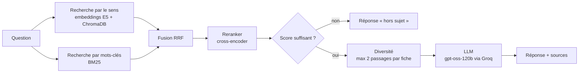

# 🎓 ÉtuDroits

**Assistant IA qui répond aux questions des étudiants, stagiaires et apprentis sur leurs droits, à partir des fiches officielles de [Service-Public.gouv.fr](https://www.service-public.gouv.fr), en citant ses sources.**

> *« Mon stage dure 3 mois, est-ce qu'on doit me payer ? »*
> → **Oui, votre stage de 3 mois vous donne droit à une gratification.** Elle est obligatoire dès que le stage dépasse 2 mois consécutifs au cours de la même année scolaire ou universitaire [1].
> *Source : [1] Stage d'un étudiant en milieu professionnel (service-public.gouv.fr)*


---

## ✨ Fonctionnalités

- **Réponses sourcées** : chaque affirmation renvoie à la fiche officielle d'où elle vient.
- **Pas d'invention** : l'assistant répond uniquement à partir des fiches. Si l'information n'y est pas, il le dit.
- **Détection du hors sujet** : une question sans rapport (« prix d'un ticket de métro ? ») est écartée sans appeler le LLM.
- **69 fiches officielles** : stages, bourses, logement et APL, alternance, études, international (voir [`sources.csv`](sources.csv)).
- **100 % gratuit** : modèles open source et offre gratuite de l'API Groq.

## 🏗️ Architecture

ÉtuDroits est un système **RAG** (*Retrieval-Augmented Generation*) : on cherche d'abord les bons passages dans les fiches, puis un LLM rédige la réponse à partir de ces passages uniquement.



**Préparation (une seule fois)** : les fiches XML de Service-Public sont téléchargées, filtrées (69 fiches), découpées par section en 1 270 passages, puis indexées (embeddings dans ChromaDB et index BM25).

**À chaque question** :
1. **Recherche hybride** : recherche par le sens (embeddings) et par mots-clés (BM25), combinées par *Reciprocal Rank Fusion*.
2. **Reranking** : un cross-encoder relit les 30 meilleurs candidats avec la question et les reclasse.
3. **Détection du hors sujet** : si le meilleur score est trop bas, on répond directement sans appeler le LLM.
4. **Diversité** : au plus 2 passages par fiche, pour couvrir plusieurs sources.
5. **Génération** : le LLM rédige la réponse à partir des 5 passages retenus, en citant ses sources.

## 📊 Évaluation

Chaque amélioration a été **mesurée** sur un jeu de test de 52 questions rédigées comme un étudiant les poserait ([`eval/questions.jsonl`](eval/questions.jsonl)), avec pour chacune la fiche attendue et les faits clés de la réponse.

- **Hit@5** : la bonne fiche est-elle parmi les 5 passages donnés au LLM ?
- **Faits@5** : ces 5 passages contiennent-ils l'information qui répond à la question (ex. « 4,50 € ») ?
- **MRR** : la bonne fiche est-elle bien classée (1 = toujours en première position) ?

| Version | Hit@1 | Hit@5 | MRR | Faits@5 |
|---|---|---|---|---|
| Embeddings seuls (baseline) | 73 % | 82 % | 0,78 | – |
| + Diversité (max 2 passages par fiche) | 73 % | 92 % | 0,80 | – |
| + Recherche hybride (BM25 + embeddings) | 79 % | 96 % | 0,85 | 79 % |
| **+ Reranker** ✅ | **79 %** | **96 %** | **0,86** | **90 %** |

*Les deux premières lignes ont été mesurées sur 51 questions ; la métrique Faits@5 et une 52ᵉ question ont été ajoutées ensuite.*

**Ce que l'évaluation a appris** :
- La **diversité** a corrigé un défaut majeur : une même fiche pouvait occuper les 5 places (logement : 29 % → 71 %).
- **BM25 et embeddings sont complémentaires** : BM25 retrouve les mots précis (« allocations familiales »), les embeddings comprennent les reformulations (« payé » → « gratification »). Leur fusion bat chacun séparément.
- **Hit@5 ne suffisait pas** : la bonne fiche pouvait être trouvée avec la mauvaise section, et la réponse était alors incomplète. La métrique Faits@5 a révélé ce problème, que le **reranker** a en grande partie corrigé (79 % → 90 %).
- **Le seuil hors sujet a été calibré sur les données** ([`eval/calibrate.py`](eval/calibrate.py)) : il bloque 8 questions hors sujet sur 12 sans bloquer aucune des 52 vraies questions. Les autres sont gérées par le LLM, qui refuse de répondre sans source.

## 🚀 Installation et utilisation

**Prérequis** : Docker, et une clé API gratuite [Groq](https://console.groq.com) (sans carte bancaire).

**1. Récupérer le code**

```bash
git clone https://github.com/bahiayoub/etudroits.git
cd etudroits
```

**2. Configurer la clé API**

Pour des raisons de sécurité, aucune clé n'est fournie dans le dépôt : chacun utilise la sienne.

1. Crée un compte sur [console.groq.com](https://console.groq.com), puis une clé dans *API Keys* (elle commence par `gsk_`).
2. Crée ton fichier `.env` à partir du modèle fourni :
   ```bash
   cp .env.example .env
   ```
3. Ouvre `.env` et colle ta clé, sans guillemets ni espaces :
   ```
   GROQ_API_KEY=gsk_ta_cle
   ```

Optionnel : une clé [Google AI Studio](https://aistudio.google.com) dans `GEMINI_API_KEY` sert de secours si la limite gratuite de Groq est atteinte. Le fichier `.env` est exclu de Git (`.gitignore`) : ta clé ne sera jamais publiée.

Sans clé, la recherche et l'évaluation fonctionnent quand même (`python ask.py --sources-only "..."`, `python -m eval.evaluate`) : seule la rédaction des réponses par le LLM en a besoin.

**3. Construire l'environnement**

```bash
docker compose build
docker compose run --rm app bash
```

Dans le conteneur :

```bash
python -m src.ingest      # télécharge les fiches officielles et garde les 69 fiches étudiantes
python -m src.index       # découpe en passages et crée l'index (2 à 5 min la première fois)

python ask.py "Mon stage dure 3 mois, est-ce qu'on doit me payer ?"   # une question
python ask.py                                                        # mode conversation
python -m eval.evaluate                                              # évaluation
```

**Interface web** (depuis le dossier du projet) :

```bash
docker compose run --rm --service-ports app python app.py
```
puis ouvrir http://localhost:7860.

## 📁 Structure du projet

```
etudroits/
├── src/
│   ├── config.py      # tous les réglages (modèles, seuils, nombre de passages…)
│   ├── ingest.py      # téléchargement et extraction des fiches XML
│   ├── chunking.py    # découpage des fiches en passages par section
│   ├── index.py       # embeddings et base vectorielle ChromaDB
│   ├── bm25.py        # recherche par mots-clés (BM25, racinisation en français)
│   ├── rerank.py      # reranker (cross-encoder)
│   ├── rag.py         # recherche hybride, fusion RRF, diversité, prompt, hors sujet
│   └── llm.py         # appel au LLM avec bascule automatique Groq → Gemini
├── eval/
│   ├── questions.jsonl  # jeu de test : 52 questions, fiches et faits attendus
│   ├── evaluate.py      # calcul de Hit@k, MRR et Faits@5
│   └── calibrate.py     # choix du seuil hors sujet
├── tests/             # tests unitaires
├── app.py             # interface web Gradio
├── ask.py             # interface en ligne de commande
├── sources.csv        # liste des 69 fiches utilisées
├── Dockerfile
└── docker-compose.yml
```

## 🛠️ Choix techniques

| Composant | Choix | Pourquoi |
|---|---|---|
| Embeddings | `intfloat/multilingual-e5-small` | Multilingue (questions et fiches en français), léger, tourne sur CPU |
| Base vectorielle | ChromaDB | Simple, locale, persistante |
| Mots-clés | BM25 (`rank-bm25`) + racinisation Snowball | « alternant » et « alternance » se reconnaissent |
| Reranker | `cross-encoder/mmarco-mMiniLMv2-L12-H384-v1` | Multilingue, assez léger pour le CPU |
| LLM | `gpt-oss-120b` via l'API Groq | Open source, rapide, offre gratuite ; Gemini en secours automatique |
| Découpage | Par section de fiche, avec titre répété | Chaque passage reste compréhensible seul (« Stage dans le privé » ≠ « Stage dans la fonction publique ») |
| Interface | Gradio | Standard pour les démos d'IA |
| Environnement | Docker (PyTorch CPU) | Reproductible, image allégée sans CUDA |

## ⚠️ Limites

- **Ne remplace pas un conseil juridique** : il faut toujours vérifier la fiche officielle citée.
- Les informations sont valables **à la date de téléchargement** des fiches. Relancer `python -m src.ingest` après avoir supprimé `data/vosdroits-latest.zip` met le corpus à jour.
- Quelques questions restent difficiles, par exemple lorsque la question et la fiche n'ont aucun mot en commun (« boursier… travailler » vs « cumuler la bourse avec un emploi »).
- La qualité dépend surtout de la recherche : si le passage contenant un montant n'est pas retrouvé, le LLM ne peut pas le donner.

## 📄 Données

Fiches « Vos droits et démarches » de **Service-Public.gouv.fr**, publiées par la DILA sous [Licence Ouverte](https://www.etalab.gouv.fr/licence-ouverte-open-licence/). Les données ne sont pas incluses dans le dépôt : elles sont téléchargées par `src/ingest.py`.

## 👤 Auteur

**Ayoub Bahi**, étudiant en Master 2 ARIAS à l'Université d'Orléans.
